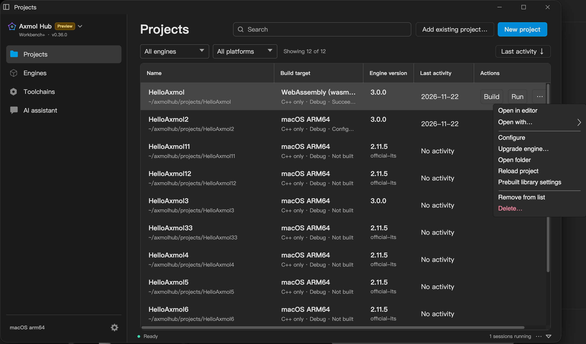
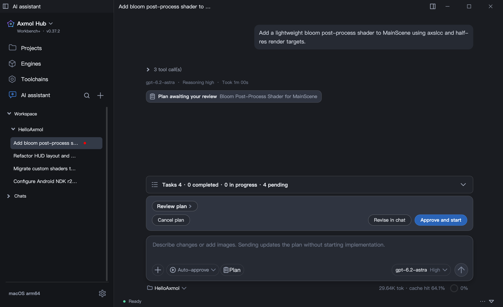
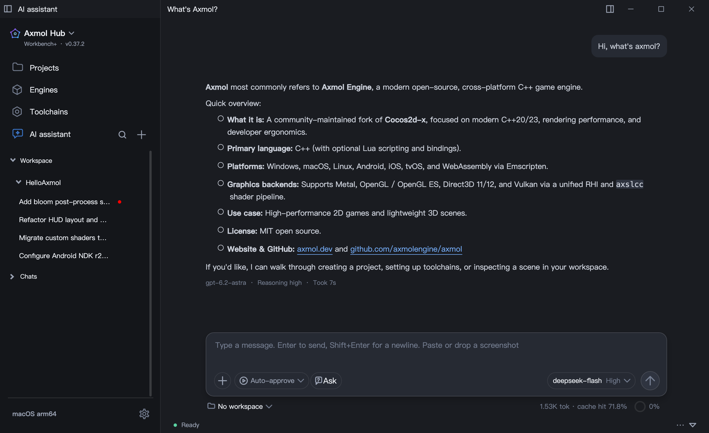
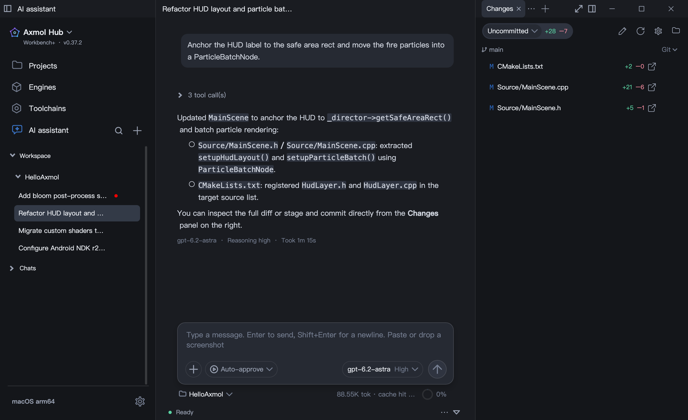
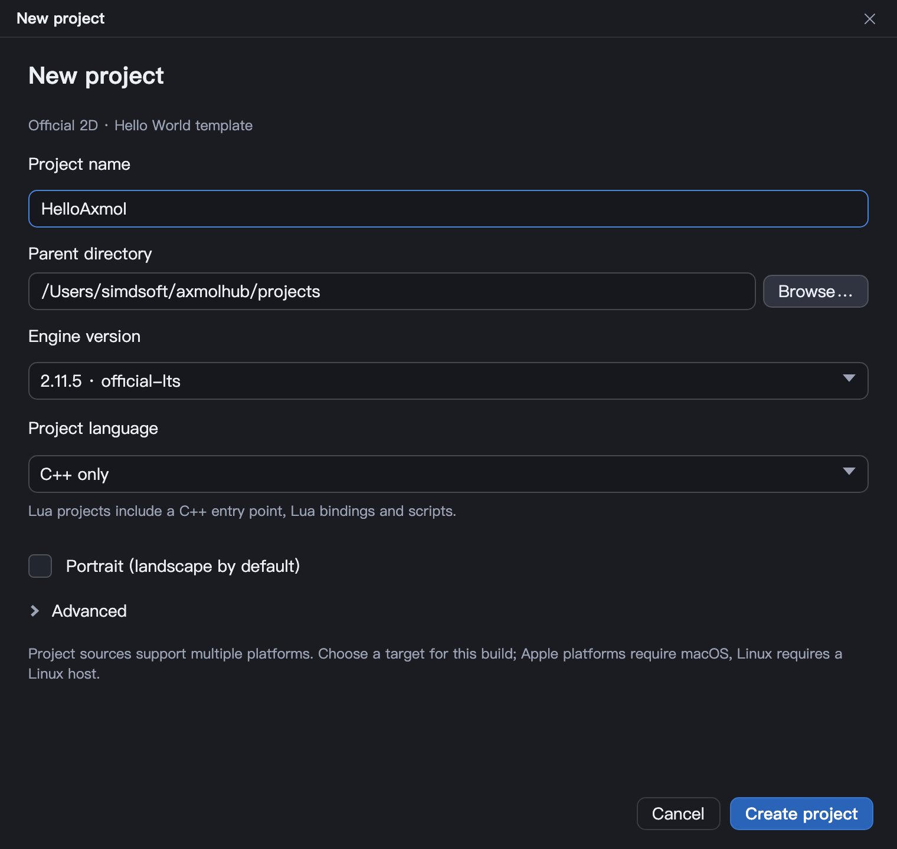
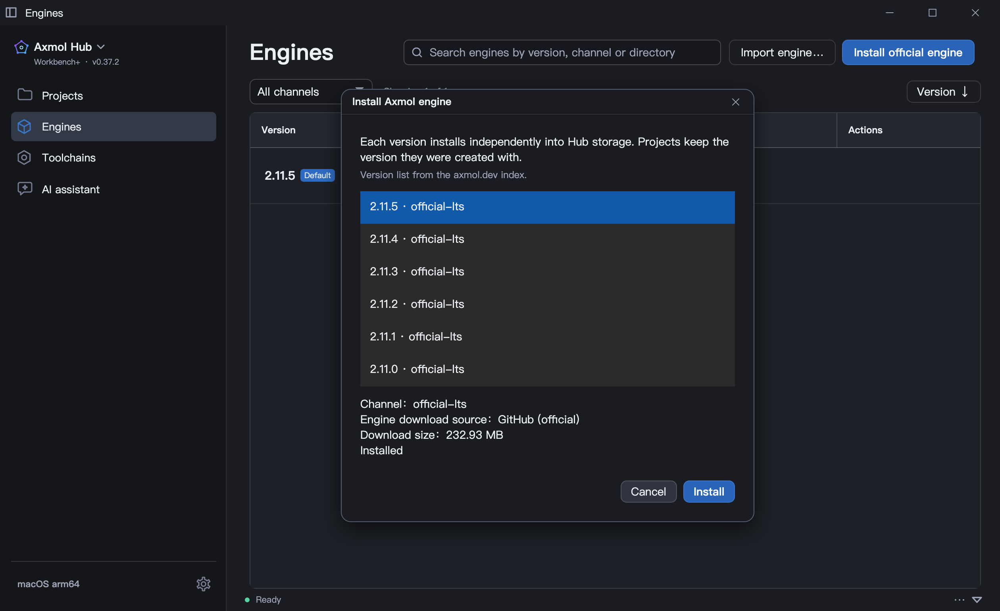
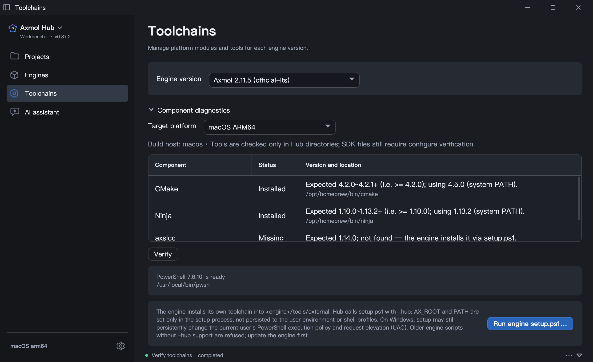
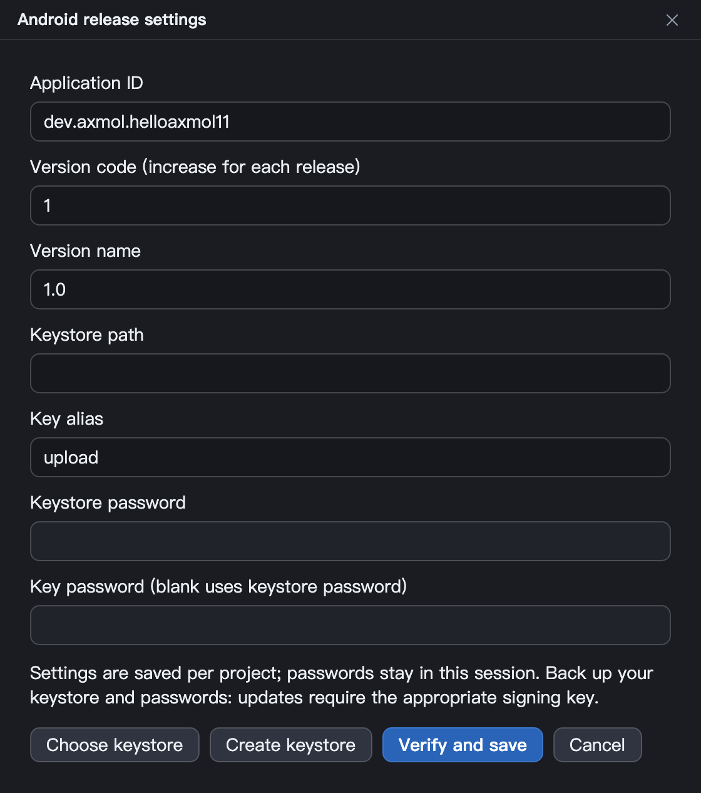
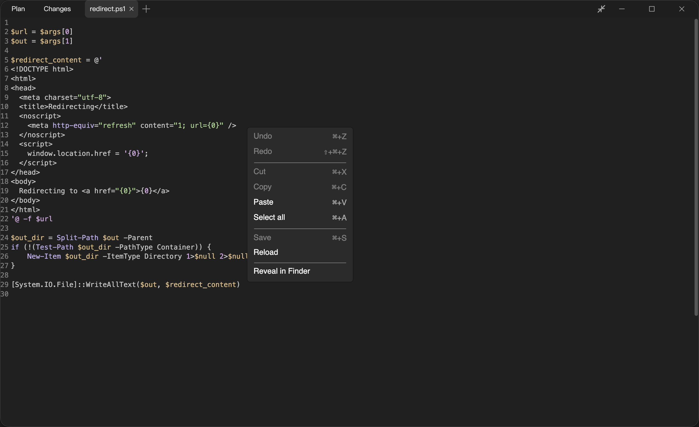

# Axmol Hub


[English](README.md) | [简体中文](README_CN.md) · [AtomGit mirror](https://atomgit.com/simdsoft/axmol-hub)

Axmol Hub is a desktop app for general-purpose AI-assisted programming and Axmol engine, project, and toolchain management. Read and edit code, run commands, or build C++ and Lua games in one place — on Windows, Linux, and macOS.

[](https://www.orcarouter.ai/ref/ref_e3b6a1445aa97ab3c359)





<details>
<summary>More screenshots</summary>

### Ask



### Git operations



### Create a project



### Engine management



### Toolchain verification



### Android release



### Built-in code editor



</details>

## Features

- **AI assistant** — inspect workspaces, edit files, and run commands with Ask, Plan, and Agent modes, approval controls, and workspace safeguards. Not limited to Axmol projects.
- **Engines and projects** — download or import Axmol engines and create C++ or C++ + Lua projects.
- **Build and toolchains** — detect and prepare development tools; build, run, and deploy through Axmol's CLI.
- **Settings and logs** — configure AI providers, language, directories, and editor; view build and run logs in-app.

Game targets include desktop, Android, WebAssembly, and Apple mobile platforms, depending on the host OS and engine version. UWP / Xbox support is limited; signing and device deployment require platform-specific tools.

## Quick start

Download a build from [Releases](https://github.com/axmolengine/axmol-hub/releases). The Windows installer bundles the .NET runtime; engines and development tools are downloaded as needed.

1. Choose your data directory, project directory, and language in **Settings**, and configure an AI provider to use the assistant.
2. Install an engine and prepare its tools on the **Toolchains** page.
3. Create a C++ or C++ + Lua project, choose a target and configuration, then build and run.

Android deployment requires an authorized device and explicit serial; Release builds use the project's [signing key](docs/android-release-signing.md). Hub does not change global environment variables or Git config. On Windows, engine setup may change the current user's PowerShell execution policy; tool installation may request elevation.

## Building from source

Install **.NET 10 SDK**, then run from the repository root:

```sh
dotnet build src/AxmolHub/AxmolHub.csproj -c Release
dotnet run --project src/AxmolHub -- --data-root ./data
```

Built with C# and Avalonia, targeting `net8.0` with support for newer runtimes. `--data-root ./data` keeps development session data local to the repository; providers and credentials remain in the current user's storage. See the [build guide](docs/building-from-source.md) for prerequisites, source layout, verification, and packaging.

## Documentation and feedback

- [CLI JSON contract](docs/cli-json-contract.md)
- [Toolchain and build delegation](docs/adr/0002-toolchain-and-build-delegated-to-engine-cmdline.md)
- [CI and SDK/runtime policy](docs/ci.md)
- [Report an issue](https://github.com/axmolengine/axmol-hub/issues) — include Hub/engine versions, OS, target, configuration, reproduction steps, and relevant logs. Redact private paths, device serials, and credentials.

## Privacy

No telemetry; logs stay on your machine. Hub contacts configured AI providers for sign-in, model lists, and requests, and downloads engine/toolchain metadata and selected files. Web search is on by default. Hub uses a supported model provider's search service when available and falls back to DuckDuckGo otherwise. Some search and fetch services may charge per request. Page fetching is controlled separately and limited to public HTTPS URLs. Its response size limit is shown in Settings, and scripts and styles are stripped before the text is returned.

## Code signing

Installers are not notarized or signed with a commercial certificate (macOS app bundles may carry a self-signed or ad-hoc signature to keep local permissions and notifications working). Windows may show a SmartScreen warning; macOS may show a Gatekeeper warning. Committer, reviewer, and approver: [@halx99](https://github.com/halx99).

On macOS, if Gatekeeper blocks the downloaded `.pkg` or installed app, remove the quarantine attribute first:

```sh
# Before opening the downloaded installer
sudo xattr -r -d com.apple.quarantine ~/Downloads/axmol-hub-*-osx-*.pkg

# Or after installation if macOS blocks launching the app
sudo xattr -r -d com.apple.quarantine "/Applications/Axmol Hub.app"
```

## License

[MIT](LICENSE). Third-party files and tools retain their own licenses; see [Third-party notices](THIRD_PARTY_NOTICES.md).
