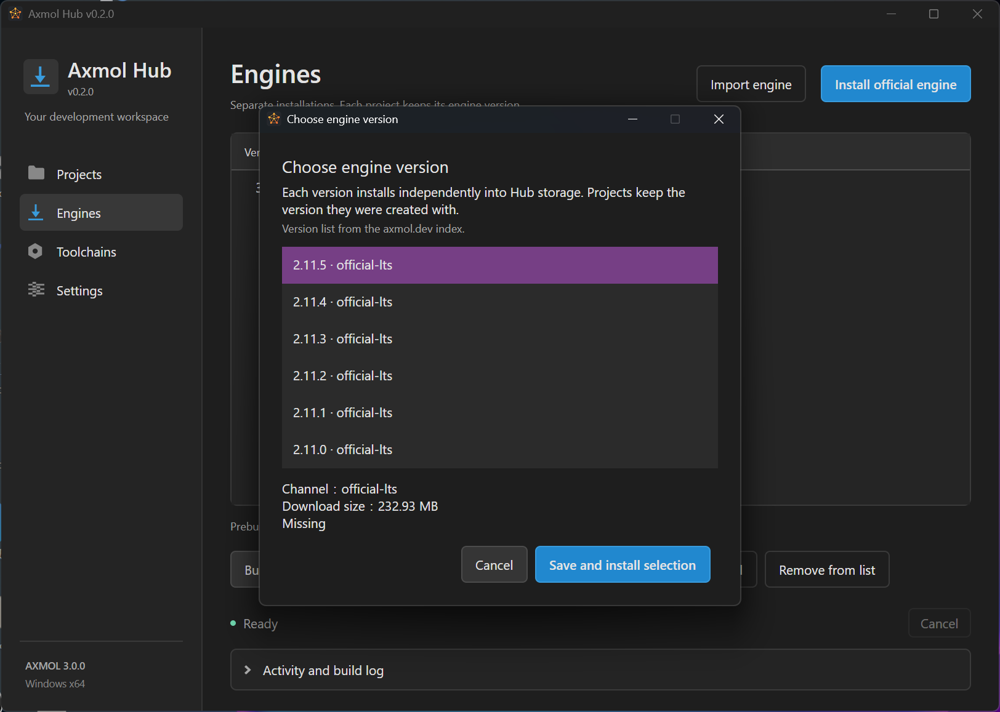

# Axmol Hub


[English](README.md) | [简体中文](README_CN.md) · [AtomGit 镜像](https://atomgit.com/simdsoft/axmol-hub)

Axmol Hub 是一款桌面应用，集通用 AI 编程助手与 Axmol 引擎、项目和工具链管理于一体。在 Windows、Linux 和 macOS 上，既能阅读和修改代码、执行命令，也能构建 C++ 和 Lua 游戏。

[](https://www.orcarouter.ai/ref/ref_e3b6a1445aa97ab3c359)



## 核心功能

- **AI 助手** — 查看工作区、编辑文件、执行命令，提供 Ask、Plan 和 Agent 模式，以及操作审批和工作区保护，不限于 Axmol 项目。
- **引擎与项目** — 下载或导入 Axmol 引擎，创建 C++ 或 C++ + Lua 项目。
- **构建与工具链** — 检测和准备开发工具，通过 Axmol CLI 构建、运行和部署。
- **设置与日志** — 配置 AI 提供商、语言、目录和编辑器，在应用内查看构建与运行日志。

游戏目标平台包括桌面、Android、WebAssembly 和 Apple 移动平台，具体取决于宿主系统和引擎版本。UWP / Xbox 支持有限；签名及设备部署需要相应平台的工具。

## 快速开始

从 [Releases](https://github.com/axmolengine/axmol-hub/releases) 下载发布版本。Windows 安装包自带 .NET 运行时，引擎和开发工具按需下载。

1. 在**设置**中选择数据目录、项目目录和语言；使用 AI 助手前配置 AI 提供商。
2. 安装引擎，并在**工具链**页面准备开发工具。
3. 创建 C++ 或 C++ + Lua 项目，选择目标平台和构建配置，然后构建、运行。

Android 部署需要已授权的设备并明确指定设备序列号；Release 构建使用项目的[签名密钥](docs/android-release-signing.md)。Hub 不修改全局环境变量或 Git 配置。在 Windows 上，引擎初始化可能修改当前用户的 PowerShell 执行策略，工具安装可能请求管理员权限。

## 从源码构建

安装 **.NET 10 SDK**，然后在仓库根目录执行：

```sh
dotnet build src/AxmolHub/AxmolHub.csproj -c Release
dotnet run --project src/AxmolHub -- --data-root ./data
```

应用使用 C# 和 Avalonia，目标框架为 `net8.0`，支持较新的运行时。`--data-root ./data` 将开发会话数据保存在仓库内，提供商和凭据仍存储在当前用户目录中。环境要求、源码布局、验收和打包方式见[构建指南](docs/building-from-source.md)。

## 文档与反馈

- [CLI JSON 契约](docs/cli-json-contract.md)
- [工具链与构建委托设计](docs/adr/0002-toolchain-and-build-delegated-to-engine-cmdline.md)
- [CI 与 SDK / 运行时策略](docs/ci.md)
- [报告问题](https://github.com/axmolengine/axmol-hub/issues) — 请附上 Hub 和引擎版本、操作系统、目标平台、构建配置、复现步骤及相关日志，并隐去私人路径、设备序列号和凭据。

## 隐私

不收集遥测，日志保留在本机。Hub 会联系已配置的 AI 提供商以登录、获取模型列表和发送请求，并下载引擎、工具链元数据及所选文件。网页搜索默认关闭，启用后使用所配置的提供商路由；搜索和抓取服务可能按请求收费。网页抓取单独控制，仅限公开 HTTPS 地址及 1 MiB 内容，并会移除脚本和样式。

## 代码签名

安装包未签名，Windows 可能显示 SmartScreen 提示，macOS 可能显示 Gatekeeper 提示。提交、审阅和批准负责人：[@halx99](https://github.com/halx99)。

## 许可证

[MIT](LICENSE)。第三方文件和工具保留各自的许可证，详见[第三方声明](THIRD_PARTY_NOTICES.md)。
