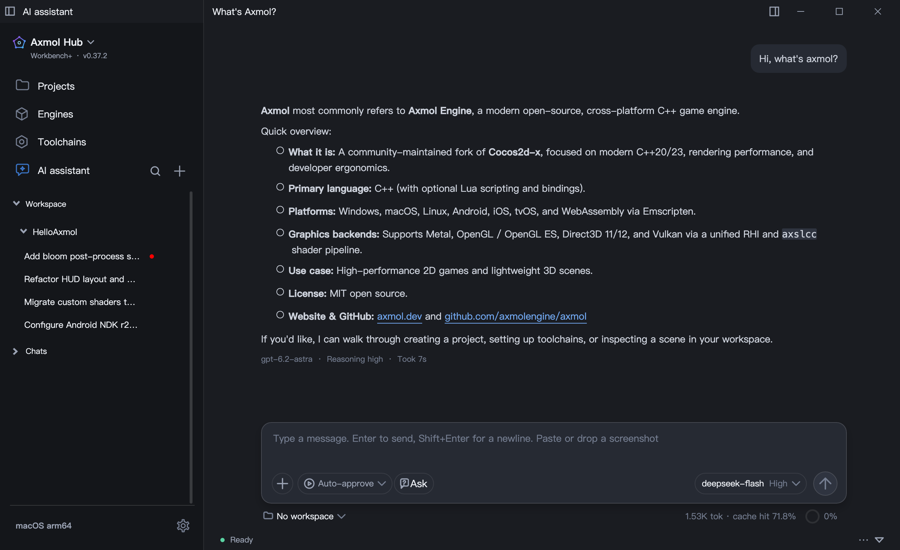
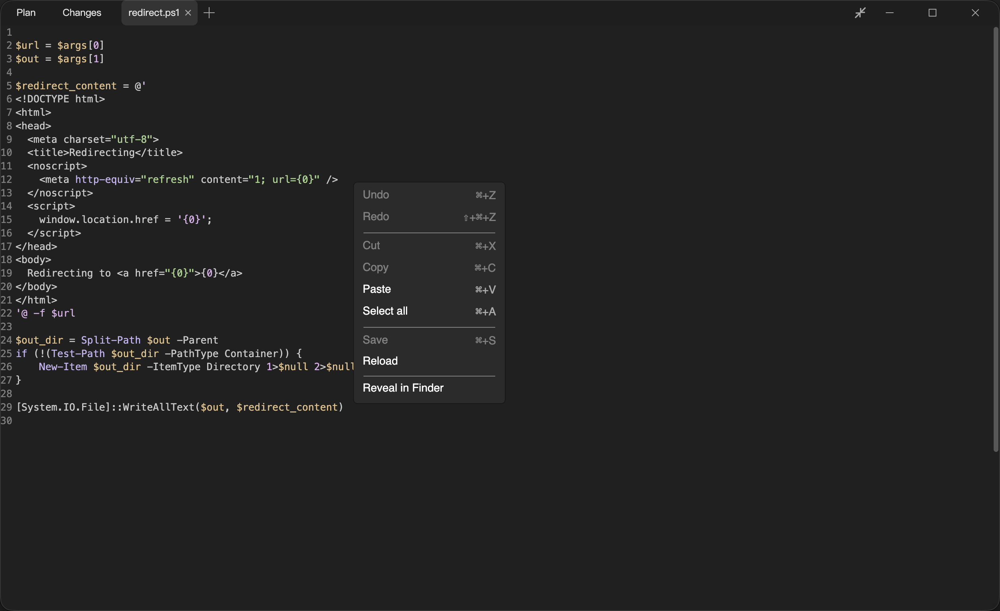

# Axmol Hub


[English](README.md) | [简体中文](README_CN.md) · [AtomGit 镜像](https://atomgit.com/simdsoft/axmol-hub)

Axmol Hub 是一款支持 Windows、Linux 和 macOS 的桌面应用。你可以用内置的通用 AI 编程助手查看和修改代码、执行命令，也可以管理 Axmol 引擎、项目和工具链，构建 C++ 和 Lua 游戏。

[](https://www.orcarouter.ai/ref/ref_e3b6a1445aa97ab3c359)


<details>
<summary>更多截图</summary>

### 提问



### Git 操作


### 创建项目


### 引擎管理


### 工具链验证


### Android 发布


### 内置代码编辑器



</details>

## 核心功能

- **AI 助手** — 可查看工作区、编辑文件和执行命令，不限于 Axmol 项目。支持提问、计划和代理模式，并提供操作审批和工作区保护。
- **引擎与项目** — 下载或导入 Axmol 引擎，创建 C++ 或 C++ + Lua 项目。
- **构建与工具链** — 检查并准备开发工具，再通过 Axmol CLI 构建、运行和部署项目。
- **设置与日志** — 配置模型提供商、语言、目录和编辑器，在应用内查看构建和运行日志。

游戏可面向桌面、Android、WebAssembly 和 Apple 移动平台，具体取决于运行 Hub 的操作系统和所用的引擎版本。对 UWP 和 Xbox 的支持有限。签名和部署到设备都需要相应平台的工具。

## 快速开始

前往 [Releases](https://github.com/axmolengine/axmol-hub/releases) 页面下载所需版本。Windows 安装包自带 .NET 运行时，引擎和开发工具按需下载。

1. 在**设置**中选择数据目录、项目目录和语言。如果要使用 AI 助手，请先配置模型提供商。
2. 安装引擎，并在**工具链**页面准备开发工具。
3. 创建 C++ 或 C++ + Lua 项目，选择目标平台和构建配置，然后构建、运行。

部署到 Android 设备前，请先授权设备并指定设备序列号。Release 构建使用项目的[签名密钥](docs/android-release-signing.md)。Hub 不修改全局环境变量或 Git 配置。在 Windows 上，初始化引擎时可能会修改当前用户的 PowerShell 执行策略。安装工具时，系统可能会提示你授予管理员权限。

## 从源码构建

安装 **.NET 10 SDK**，然后在仓库根目录执行：

```sh
dotnet build src/AxmolHub/AxmolHub.csproj -c Release
dotnet run --project src/AxmolHub -- --data-root ./data
```

Hub 使用 C# 和 Avalonia 开发，目标框架为 `net8.0`，也支持更新版本的 .NET 运行时。`--data-root ./data` 会将开发会话数据保存在仓库内，但模型提供商的配置和凭据仍保存在当前用户的存储目录中。环境要求、源码布局、验证步骤和打包方法见[构建指南](docs/building-from-source.md)。

## 文档与反馈

- [CLI JSON 契约](docs/cli-json-contract.md)
- [由 Axmol CLI 管理工具链和构建](docs/adr/0002-toolchain-and-build-delegated-to-engine-cmdline.md)
- [CI 与 SDK / 运行时策略](docs/ci.md)
- [报告问题](https://github.com/axmolengine/axmol-hub/issues) — 请附上 Hub 和引擎版本、操作系统、目标平台、构建配置、复现步骤及相关日志，并隐去含有个人信息的路径、设备序列号和凭据。

## 隐私

Hub 不收集遥测数据，日志只保存在本机。Hub 会向你配置的模型提供商发送请求，用于登录、获取模型列表和调用模型。Hub 也会下载引擎和工具链的元数据，以及你选中的文件。

网页搜索默认开启。Hub 优先使用适用的模型提供商搜索服务；没有可用的提供商搜索服务时，会改用 DuckDuckGo。部分搜索和网页抓取服务可能按请求收费。网页抓取可单独开关，只能访问公开的 HTTPS 地址。响应体大小上限见设置，抓取时会移除脚本和样式。

## 代码签名

安装包未经商业证书签名或 Apple 公证（macOS 应用包可能带有自签或 ad-hoc 签名以维持本地权限与通知功能）。Windows 可能显示 SmartScreen 提示，macOS 可能显示 Gatekeeper 提示。[@halx99](https://github.com/halx99) 负责提交、审阅和批准。

在 macOS 上，如果 Gatekeeper 拦截了下载的 `.pkg` 安装包或已安装的应用，可先移除隔离属性：

```sh
# 打开下载的安装包之前
sudo xattr -r -d com.apple.quarantine ~/Downloads/axmol-hub-*-osx-*.pkg

# 或安装后若仍被拦截启动
sudo xattr -r -d com.apple.quarantine "/Applications/Axmol Hub.app"
```

## 许可证

[MIT](LICENSE)。第三方文件和工具保留各自的许可证，详见[第三方声明](THIRD_PARTY_NOTICES.md)。
